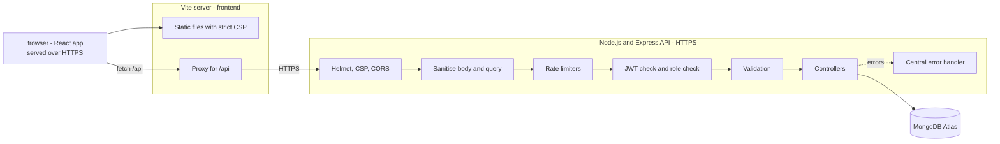

# HustleHub+ - Secure Freelance Marketplace Platform
### Part 2: Secure Stack (React, Node.js, Express, MongoDB)

**Module:** Information Systems 3D INSY7314

**Members:**

ST10450571 - Erin Sarjoo

ST10453511 - Moegammad Alexander

ST10434391 - Nkosana Mavunhla

**Demonstration video:** _add your link here_

---

## 1. Project Overview

**HustleHub+** is a secure freelance marketplace. **Freelancers** list services ("gigs"), **clients** browse and book them, and every booking creates a transaction so freelancers can see what they have earned and an estimate of the tax they may owe. Each booking records a payment transaction in the database.

The platform handles credentials, bookings and income data, so security is a design requirement from the start, not a later addition.

### Who uses it

| Role | What they can do |
|---|---|
| **Client** | Browse and search gigs, book a gig, see their own bookings and payments. |
| **Freelancer** | Create, edit and delete their own gigs, see bookings they received, mark them completed, track income and estimated tax. |
| **Admin** | See every user, booking and transaction, and remove any gig for moderation. Admins cannot book gigs or create gigs. |

Admins cannot register through the app. The first admin is created with `npm run seed:admin`.

### How the project grew

1. **Part 1 - Secure foundations:** Express API, registration and login, bcrypt, JWT, HTTPS, validation, safe errors, Postman tests.
2. **Part 2 - Secure stack (this version):** MongoDB Atlas, gigs, bookings, transactions, income tracking, role-based access control, a React frontend, rate limiting, Helmet and a Content Security Policy, Newman API tests and Vitest frontend tests.
3. **Part 3 - DevSecOps (planned):** containers, CI/CD pipeline, automated security scans, monitoring.

### What changed since Part 1

- User data moved from a JSON file to MongoDB Atlas, using Mongoose models.
- Added gigs, bookings, transactions and an income summary.
- Added three roles and role checks on every protected route, plus ownership checks.
- Added a React frontend.
- Added a Content Security Policy, a locked-down CORS list and rate limiting on login, registration, bookings and gig changes.
- Sanitisation now removes NoSQL operators and HTML from every request.
- Login now takes the same time whether or not the email exists.
- The Postman collection grew from 13 to 114 requests and runs automatically with Newman.
- Added 54 automated frontend tests.

---

## 2. Architecture

### Trust boundaries

- **Browser to servers:** everything is untrusted input. The browser can never decide a price, a role or an owner.
- **API to database:** only the API holds the database credentials (in `.env`, never committed).
- The React app hides links and pages a role should not see, but that is only convenience. **Every rule is enforced again on the API.**

### Request flow through the API

1. The request arrives over HTTPS.
2. **Helmet** adds security headers, including a Content Security Policy. **CORS** checks the origin.
3. The JSON body is read (maximum 10 KB).
4. The **sanitiser** removes keys that start with `$` or contain `.` (NoSQL injection) and strips HTML tags from every text value (scripting attacks). Passwords are left untouched.
5. A **general rate limiter** runs for every `/api` call.
6. The route's own limiter runs if it has one (login, register, bookings, gig changes).
7. **`protect`** checks the JWT signature, algorithm and expiry, then reloads the user from MongoDB.
8. **`requireRole`** checks the user's role is allowed on that route.
9. **express-validator** checks every field. Invalid input is rejected with `400` and field-level messages.
10. The **controller** does the work. It also checks ownership, for example that a gig belongs to the freelancer editing it.
11. Any error goes to one **central handler** that logs the details on the server and sends the client a short, safe message.
