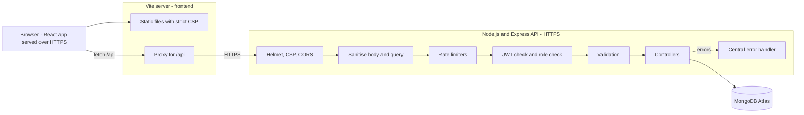
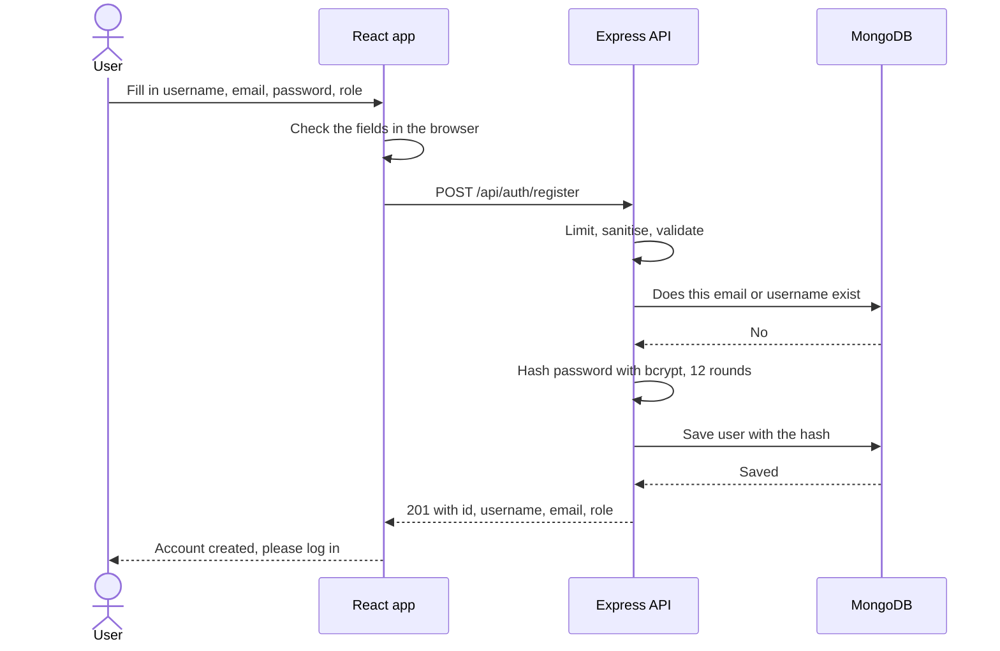
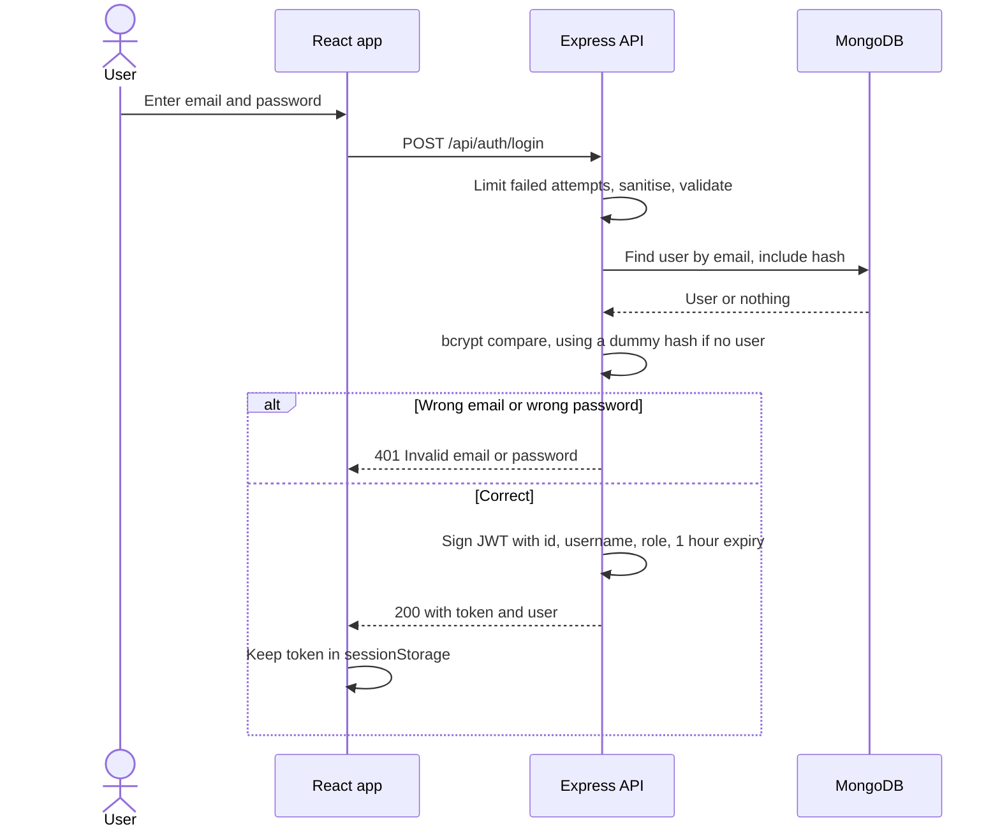
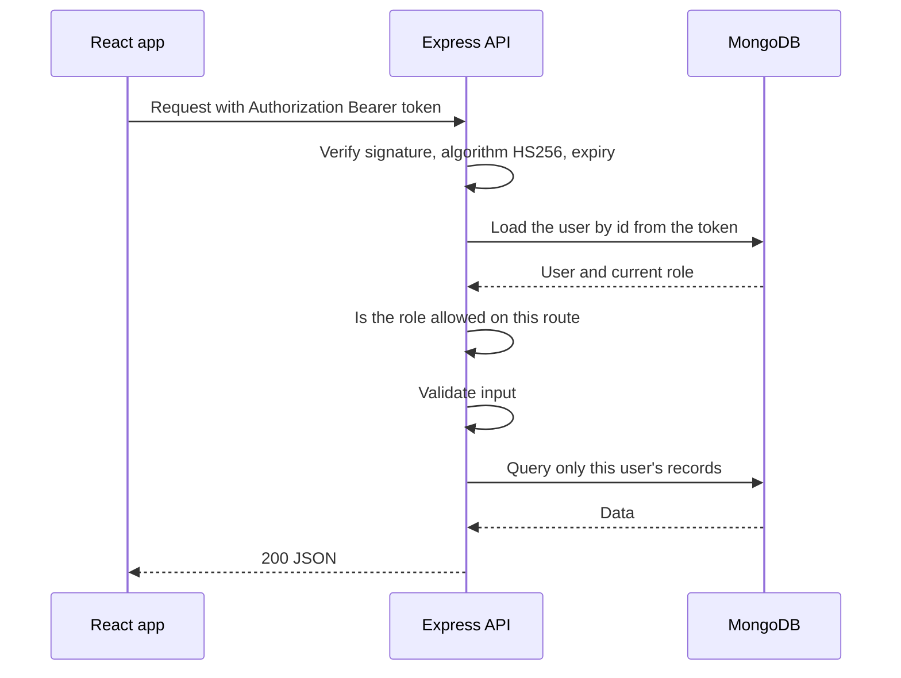
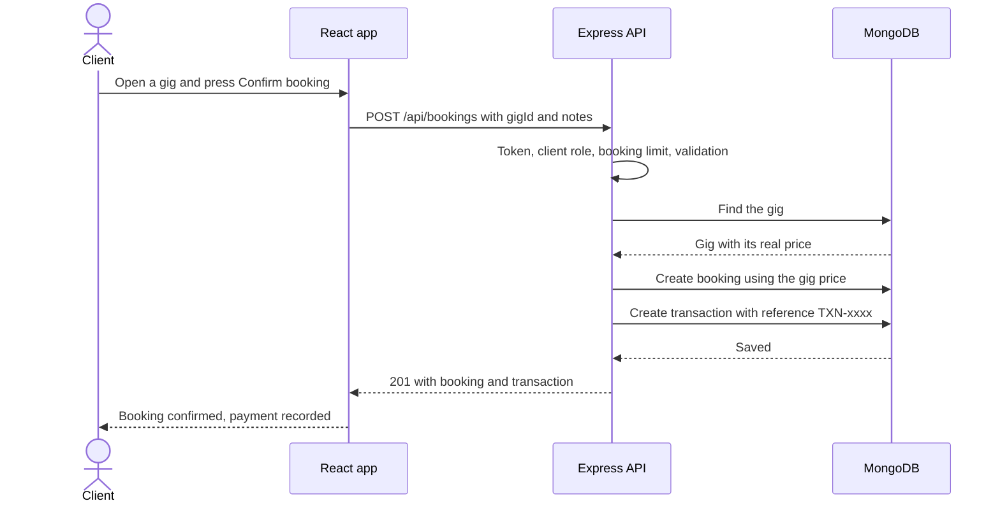

# HustleHub+ - Secure Freelance Marketplace Platform
### Part 2: Secure Stack (React, Node.js, Express, MongoDB)

**Module:** Information Systems 3D INSY7314

**Members:**

ST10450571 - Erin Sarjoo

ST10453511 - Moegammad Alexander

ST10434391 - Nkosana Mavunhla

**Demonstration video:** _add your link here_

---

## 1. Project Overview

**HustleHub+** is a secure freelance marketplace. **Freelancers** list services ("gigs"), **clients** browse and book them, and every booking creates a transaction so freelancers can see what they have earned and an estimate of the tax they may owe. Each booking records a payment transaction in the database.

The platform handles credentials, bookings and income data, so security is a design requirement from the start, not a later addition.

### Who uses it

| Role | What they can do |
|---|---|
| **Client** | Browse and search gigs, book a gig, see their own bookings and payments. |
| **Freelancer** | Create, edit and delete their own gigs, see bookings they received, mark them completed, track income and estimated tax. |
| **Admin** | See every user, booking and transaction, and remove any gig for moderation. Admins cannot book gigs or create gigs. |

Admins cannot register through the app. The first admin is created with `npm run seed:admin`.

### How the project grew

1. **Part 1 - Secure foundations:** Express API, registration and login, bcrypt, JWT, HTTPS, validation, safe errors, Postman tests.
2. **Part 2 - Secure stack (this version):** MongoDB Atlas, gigs, bookings, transactions, income tracking, role-based access control, a React frontend, rate limiting, Helmet and a Content Security Policy, Newman API tests and Vitest frontend tests.
3. **Part 3 - DevSecOps (planned):** containers, CI/CD pipeline, automated security scans, monitoring.

### What changed since Part 1

- User data moved from a JSON file to MongoDB Atlas, using Mongoose models.
- Added gigs, bookings, transactions and an income summary.
- Added three roles and role checks on every protected route, plus ownership checks.
- Added a React frontend.
- Added a Content Security Policy, a locked-down CORS list and rate limiting on login, registration, bookings and gig changes.
- Sanitisation now removes NoSQL operators and HTML from every request.
- Login now takes the same time whether or not the email exists.
- The Postman collection grew from 13 to 114 requests and runs automatically with Newman.
- Added 54 automated frontend tests.

---

## 2. Architecture



### Trust boundaries

- **Browser to servers:** everything is untrusted input. The browser can never decide a price, a role or an owner.
- **API to database:** only the API holds the database credentials (in `.env`, never committed).
- The React app hides links and pages a role should not see, but that is only convenience. **Every rule is enforced again on the API.**

### Request flow through the API

1. The request arrives over HTTPS.
2. **Helmet** adds security headers, including a Content Security Policy. **CORS** checks the origin.
3. The JSON body is read (maximum 10 KB).
4. The **sanitiser** removes keys that start with `$` or contain `.` (NoSQL injection) and strips HTML tags from every text value (scripting attacks). Passwords are left untouched.
5. A **general rate limiter** runs for every `/api` call.
6. The route's own limiter runs if it has one (login, register, bookings, gig changes).
7. **`protect`** checks the JWT signature, algorithm and expiry, then reloads the user from MongoDB.
8. **`requireRole`** checks the user's role is allowed on that route.
9. **express-validator** checks every field. Invalid input is rejected with `400` and field-level messages.
10. The **controller** does the work. It also checks ownership, for example that a gig belongs to the freelancer editing it.
11. Any error goes to one **central handler** that logs the details on the server and sends the client a short, safe message.

---

## 3. Data Flow Diagrams

### 3.1 Register



1. The user enters a username, email, password and chooses **client** or **freelancer**. The React form checks the same rules as the server so mistakes are caught immediately.
2. The browser sends `POST /api/auth/register` over HTTPS.
3. The API applies the **registration rate limit** (20 per hour per address), strips NoSQL operators and HTML, then validates: username 3-30 letters, numbers or underscores; a valid email; a password of 8-72 characters with upper case, lower case, a number and a special character; a role of only `client` or `freelancer`. **`admin` is rejected here**, so nobody can promote themselves.
4. The API checks the email and the lower-cased username are unused. If one is taken it answers `409`.
5. The password is hashed with **bcrypt using 12 rounds**. The plain password is never stored or logged.
6. The user is saved. The hash is stored with `select: false`, so it is never returned by any query by default.
7. The response contains only `id`, `username`, `email` and `role`. The frontend sends the user to the login page.

### 3.2 Login and token issue



1. The user enters their email and password.
2. The API applies the **login rate limit**: 10 *failed* attempts per 15 minutes per address. Successful logins do not count, so real users are not locked out, but password guessing is throttled.
3. The input is sanitised and validated. Both fields must be real strings, so a request like `{"email": {"$gt": ""}}` is rejected with `400` before it reaches the database.
4. The API looks the user up by email and compares the password with `bcrypt.compare`.
5. If the email does not exist, the API still runs `bcrypt.compare` against a dummy hash. Both failure cases take the same time and return the same message, so an attacker cannot learn which emails are registered.
6. On success the API signs a **JWT** containing only `id`, `username` and `role`, using HS256 and the secret from `.env`. It expires after 1 hour.
7. The browser keeps the token in `sessionStorage` and sends it as `Authorization: Bearer <token>` on every later request.

### 3.3 A protected request (how roles are enforced)



1. `protect` rejects a missing, malformed, expired or tampered token with `401`. The algorithm is pinned to HS256, so unsigned tokens (`alg: none`) are refused.
2. It then **reloads the user from MongoDB**. A deleted account, or a changed role, takes effect immediately instead of when the token expires.
3. `requireRole('freelancer')` and similar checks return `403` for roles that are not allowed.
4. Controllers add ownership rules. A freelancer who edits a gig they do not own gets `403`. Bookings and transactions are always queried with the user's own id, so another user's booking looks exactly like one that does not exist (`404`).

### 3.4 Booking a gig and recording the transaction



1. Only users with the **client** role can reach this route. The **booking limit** is 5 per 10 minutes for each user.
2. The request contains only a `gigId` and optional notes. **The price is never taken from the request.** It is read from the gig stored in MongoDB.
3. The API creates the **booking** and then the **transaction** (`amount`, `currency: ZAR`, a random `TXN-` reference, client, freelancer, gig).
4. If the transaction cannot be saved, the booking is deleted again, so a booking never exists without its transaction.
5. The booking and transaction keep a copy of the gig title and price. Editing or deleting the gig later never changes the history.
6. The freelancer's **income** is the sum of their transactions. `GET /api/transactions/income` returns total income, an estimated tax figure and income after tax.

---

## 4. Security Measures

| Area | What we do | Where |
|---|---|---|
| Passwords | bcrypt, 12 rounds, never returned. Passwords are limited to 72 characters because bcrypt ignores anything longer. | `controllers/authController.js` |
| Tokens | JWT with HS256 pinned, 1 hour expiry, minimal payload, secret of at least 32 characters required at startup. | `controllers/authController.js`, `middleware/authMiddleware.js`, `config/config.js` |
| Authentication | Every gig, booking, transaction and admin route requires a valid JWT. | `routes/*.js` |
| Role-based access | `requireRole` on routes, ownership checks in controllers, queries scoped to the user's id. | `middleware/authMiddleware.js`, `controllers/*.js` |
| Privilege escalation | `admin` cannot be chosen at registration. Gig owner and price are never read from the request. | `middleware/validationMiddleware.js`, `controllers/gigController.js` |
| Validation | express-validator on every body, query and id. Every text field must be a real string. | `middleware/validationMiddleware.js` |
| Sanitisation | NoSQL operators and HTML removed from body and query. Search text is regex-escaped. Mongoose `sanitizeFilter` is on. | `middleware/sanitizeMiddleware.js`, `utils/escapeRegex.js`, `config/db.js` |
| Rate limiting | General, login (failed only), register, booking, gig writes. Clear 429 message with how long to wait. | `middleware/rateLimiters.js` |
| Security headers | Helmet, a Content Security Policy that blocks everything, no framing, no referrer, no caching of API responses. | `middleware/securityHeaders.js` |
| CORS | Only the frontend origins in `CLIENT_ORIGIN` may call the API from a browser. | `middleware/securityHeaders.js` |
| HTTPS | Both servers run over HTTPS with a locally generated certificate. | `server.js`, `hustlehub-frontend/vite.config.js` |
| Safe errors | One central handler. Stack traces, file paths and database messages stay in the server log. | `middleware/errorMiddleware.js` |
| Frontend | React escapes all text, no `dangerouslySetInnerHTML`, strict CSP, token cleared when the tab closes. | `hustlehub-frontend/src` |
| Dependencies | `npm audit` reports 0 vulnerabilities for both applications. | `package.json` |
| Audit trail | Registrations, logins, failures, forbidden attempts, bookings and rate-limit hits are logged. | `utils/logger.js` |

### Content Security Policy

The API only returns JSON, so its policy is: `default-src 'none'; base-uri 'none'; form-action 'none'; frame-ancestors 'none'`. Nothing from an API response can load a script, style, image or frame.

The React app (production build) uses: `default-src 'self'; script-src 'self'; style-src 'self'; img-src 'self' data:; font-src 'self'; connect-src 'self'; object-src 'none'; base-uri 'self'; form-action 'self'; frame-ancestors 'none'`. Fonts are self-hosted and the build contains no inline scripts, so no `unsafe-inline` is needed. The development server (`npm run dev`) must allow inline scripts and websockets for hot reloading, so it uses a looser policy. Run `npm start` to see the strict one.

---

## 5. Why We Chose These Techniques

| Decision | What we chose | What we did not choose, and why |
|---|---|---|
| Authentication | **JWT bearer tokens** | **Server-side sessions** store a session record for every login and must look it up on every request. That needs a shared session store once there is more than one server, and cookie sessions need extra CSRF protection. JWTs are checked with the secret alone, work the same for the React app and Postman, and scale without shared state. The cost is that a token cannot be cancelled before it expires, so we keep it short (1 hour) and reload the user on every request, which means deleted accounts and changed roles take effect straight away. |
| Password hashing | **bcrypt, 12 rounds** | **SHA-256 or MD5** are fast, which helps attackers. **argon2id** is also excellent, but needs a native build that often fails on student Windows machines. bcrypt is slow on purpose, salts every password, and its cost can be raised over time. We use `bcryptjs` (pure JavaScript, no native build). |
| Token storage in the browser | **sessionStorage** | **localStorage** keeps the token after the browser closes. **httpOnly cookies** cannot be read by scripts, but they are sent automatically, which brings CSRF risk, and they behave awkwardly across the two local servers. With sessionStorage the token disappears when the tab closes, the browser never attaches it automatically (so CSRF does not apply), and a strict CSP plus React's escaping reduce the XSS risk. |
| Database | **MongoDB Atlas with Mongoose** | A relational database would also work. MongoDB is the "M" in MERN, stores gigs naturally as documents, and Mongoose schemas give a second layer of validation. |
| Validation | **express-validator** | **Joi or Zod** are good schema libraries, but express-validator is built for Express, and does validation and sanitising in one chain per field. |
| NoSQL injection | **Remove `$` keys, require strings, Mongoose `sanitizeFilter`** | Relying on only one layer. Three independent layers mean one mistake does not become a breach. |
| Rate limit storage | **In memory** | **Redis** is needed when several servers share limits. This project runs one server, so in-memory is simpler and has no extra service to run. Part 3 can move to Redis. |
| Failed-login limit | **Count failed attempts only** | Counting every login would lock out normal users. |
| Others' bookings | **Return 404, not 403** | A `403` tells an attacker the booking exists. A `404` reveals nothing. |
| Gig deletion | **Hard delete, with a copy of the title and price kept in bookings** | **Soft delete** leaves hidden records forever. Copying the details keeps history correct without them. |
| Frontend to API | **Vite proxy** (`/api`) | Calling the API directly means the browser must accept a second self-signed certificate and every request becomes cross-origin. The proxy keeps one origin and a strict `connect-src 'self'`. CORS is still locked down for any direct calls. |
| Money | **Numbers rounded to 2 decimals, in rand** | **Integer cents** is the safer production choice. For this scope, prices are validated to R1 - R100 000 and rounded on the server. |
| API test runner | **Newman through `npx`** | Installing Newman in the project adds dozens of dependency warnings that cannot be fixed upstream. Using `npx` with a pinned version keeps `npm audit` at zero for the application. |

---

## 6. Role Permissions

| Action | Client | Freelancer | Admin | Not logged in |
|---|---|---|---|---|
| Register and log in | Yes | Yes | Log in only | Yes |
| Browse and view gigs | Yes | Yes | Yes | No (401) |
| Create a gig | No (403) | Yes | No (403) | No (401) |
| Edit a gig | No (403) | Only their own (403 otherwise) | No (403) | No (401) |
| Delete a gig | No (403) | Only their own (403 otherwise) | Any gig | No (401) |
| Book a gig | Yes | No (403) | No (403) | No (401) |
| View bookings | Their own | Ones they received | All | No (401) |
| Mark a booking completed | No (403) | Only their own (404 otherwise) | No (403) | No (401) |
| View transactions | Their own payments | Their own earnings | All | No (401) |
| View income summary | No (403) | Yes | No (403) | No (401) |
| View users and platform summary | No (403) | No (403) | Yes | No (401) |

---

## 7. API Reference

Base URL: `https://localhost:5000`. Every response has `success` and either `data` or `message`. Send the token as `Authorization: Bearer <token>`.

| Method | Endpoint | Who | Rate limit | Description |
|---|---|---|---|---|
| GET | `/api/health` | Anyone | none | Liveness check |
| POST | `/api/auth/register` | Anyone | 20 per hour per address | Create a client or freelancer account |
| POST | `/api/auth/login` | Anyone | 10 failed per 15 minutes per address | Log in and receive a JWT |
| GET | `/api/auth/profile` | Logged in | general | Own profile |
| GET | `/api/gigs` | Logged in | general | Active gigs. Query: `q`, `category`, `minPrice`, `maxPrice`, `sort` (`newest`, `price_asc`, `price_desc`), `page`, `limit` |
| GET | `/api/gigs/mine` | Freelancer | general | All of the freelancer's own gigs |
| GET | `/api/gigs/:id` | Logged in | general | One gig |
| POST | `/api/gigs` | Freelancer | 30 per 15 minutes per user | Create a gig |
| PUT | `/api/gigs/:id` | Freelancer (owner) | 30 per 15 minutes per user | Update a gig |
| DELETE | `/api/gigs/:id` | Freelancer (owner) or admin | 30 per 15 minutes per user | Delete a gig |
| POST | `/api/bookings` | Client | 5 per 10 minutes per user | Book a gig and create its transaction |
| GET | `/api/bookings` | Logged in | general | Bookings for the user's role |
| GET | `/api/bookings/:id` | Client or freelancer on it, or admin | general | One booking |
| PATCH | `/api/bookings/:id/complete` | Freelancer (owner) | general | Mark a booking completed |
| GET | `/api/transactions` | Logged in | general | Transactions for the user's role |
| GET | `/api/transactions/income` | Freelancer | general | Income, estimated tax, income after tax, income per gig |
| GET | `/api/admin/users` | Admin | general | All users (no password data) |
| GET | `/api/admin/summary` | Admin | general | Platform totals |

The general limit is 300 requests per 15 minutes per address for all `/api` routes.

### Example: create a gig

```json
POST /api/gigs
{
  "title": "Logo design",
  "description": "I will design a clean, modern logo for your business.",
  "category": "Design",
  "price": 450,
  "deliveryDays": 3
}
```

Success (`201`):

```json
{
  "success": true,
  "message": "Gig created.",
  "data": {
    "id": "6650f1c2a1b2c3d4e5f60718",
    "title": "Logo design",
    "category": "Design",
    "price": 450,
    "deliveryDays": 3,
    "isActive": true,
    "freelancer": { "id": "6650f0a1a1b2c3d4e5f60001", "username": "Moe_Alex" }
  }
}
```

### Example: book a gig

```json
POST /api/bookings
{ "gigId": "6650f1c2a1b2c3d4e5f60718", "notes": "Please use blue tones." }
```

Success (`201`) returns both records. Note `amount` comes from the gig, not the request:

```json
{
  "success": true,
  "message": "Booking confirmed.",
  "data": {
    "booking": { "id": "...", "gigTitle": "Logo design", "price": 450, "status": "confirmed" },
    "transaction": { "id": "...", "reference": "TXN-62D255A6F6", "amount": 450, "currency": "ZAR", "status": "completed" }
  }
}
```

### Common errors

| Status | Meaning | Example body |
|---|---|---|
| 400 | Validation failed | `{ "success": false, "message": "Validation failed.", "errors": [{ "field": "price", "message": "Price must be a number between R1 and R100 000." }] }` |
| 401 | Missing, invalid or expired token | `{ "success": false, "message": "Not authorised. Token is invalid or has expired." }` |
| 403 | Role or ownership not allowed | `{ "success": false, "message": "You can only modify your own gigs." }` |
| 404 | Not found, or not yours | `{ "success": false, "message": "Booking not found." }` |
| 409 | Duplicate | `{ "success": false, "message": "An account with that email already exists." }` |
| 413 | Body over 10 KB | `{ "success": false, "message": "Request body is too large." }` |
| 429 | Rate limited | `{ "success": false, "message": "You are booking too quickly. Please wait before making another booking.", "retryAfterSeconds": 600 }` |
| 500 | Unexpected | `{ "success": false, "message": "An unexpected error occurred. Please try again later." }` |

---

## 8. Running the Project

### Prerequisites

- **Node.js 22.12 or newer** (check with `node -v`) and npm
- **OpenSSL** (included with Git Bash on Windows)
- A **MongoDB Atlas** account (the free tier is enough)
- Postman (optional, for manual testing)

### Step 1 - Set up MongoDB Atlas

1. Create a free cluster in MongoDB Atlas.
2. **Database Access:** add a database user with a password.
3. **Network Access:** add your current IP address.
4. **Connect > Drivers:** copy the connection string. Replace the password placeholder, and add the database name before the `?`, for example `.../hustlehub?retryWrites=true&w=majority`. If the password contains special characters, URL-encode them.

### Step 2 - Run the backend

```bash
cd hustlehub-backend
npm install

# create your settings file, then open .env and fill in every value
cp .env.example .env
# generate a JWT secret and paste it into JWT_SECRET
node -e "console.log(require('crypto').randomBytes(64).toString('hex'))"

# create the HTTPS certificate (answers do not matter for local use)
mkdir certs
openssl req -nodes -new -x509 -keyout certs/key.pem -out certs/cert.pem -days 365

# create the first administrator from ADMIN_* in .env
npm run seed:admin

# start the API
npm run dev
```

You should see `MongoDB connected` and `HustleHub+ backend listening securely on https://localhost:5000`.

### Step 3 - Run the frontend

Open a second terminal:

```bash
cd hustlehub-frontend
npm install
npm run dev
```

Open **https://localhost:5173**. The browser warns about the self-signed certificate: choose **Advanced**, then **Proceed to localhost**. You only need to do this once.

To see the strict Content Security Policy that the production build uses, run `npm start` instead (it builds, then serves the build on the same address).

### Try it

1. Register a **freelancer**, log in, and create a gig under **My gigs**.
2. Log out. Register a **client**, log in, open the gig and press **Confirm booking**.
3. Log in as the freelancer again. Check **Bookings received**, mark the booking completed, and open **Income**.
4. Log in with the admin account from `.env` and open **Admin**.

---

## 9. Testing

### Backend: Postman collection and Newman

The collection `hustlehub-backend/postman/HustleHub.postman_collection.json` has **114 requests in 10 folders**, each with automated assertions: authentication, gig CRUD and ownership, bookings and transactions, income, admin, rate limiting (bookings and logins), error handling and CORS, and security headers. It covers success and failure cases for every endpoint.

Run it with Newman:

```bash
cd hustlehub-backend
npm test
```

`npm test` does the following, so it is repeatable and never touches your real data:

1. Empties a separate database called `hustlehub_test` (it refuses to run on any database whose name does not contain "test", or on your real one).
2. Creates a test admin.
3. Starts the API on port 5055.
4. Runs the collection with Newman.
5. Stops the API and writes reports to `hustlehub-backend/newman/reports/` (`newman-report.html` and `newman-report.json`).

The command exits with an error if any assertion fails. Latest result: **114 requests, 300 assertions, 0 failed**.

To run the collection by hand in Postman, import the collection and `HustleHub.postman_environment.json`, set `adminEmail` and `adminPassword` to your `ADMIN_*` values, turn off SSL certificate verification, and run the folders in order. The login rate-limit folder is last. Restart the API before running it again, because its counters live in memory.

### Frontend: Vitest and Testing Library

```bash
cd hustlehub-frontend
npm test
```

**54 tests in 12 files** check rendering and behaviour:

- `GigCard` renders server text as plain text (an injected `` stays harmless text).
- `GigForm` shows an error for each invalid field, blocks submission, then submits cleaned numbers.
- `LoginPage` and `RegisterPage` validate in the browser, call the API with the typed values, and show server errors.
- `Navbar` shows the right links for each role.
- `ProtectedRoute` redirects logged-out visitors and blocks the wrong role.
- `GigsPage` loads, searches, filters and pages through gigs, and shows empty and error states.
- `GigDetailPage` lets a client book and shows the reference, explains rate limiting, hides booking from freelancers, and asks an admin to confirm before removing a gig.
- `IncomePage` shows income, estimated tax and income after tax.
- The API client adds the token, explains `429` with a wait time, never shows raw `500` messages, and treats an expired token differently from a wrong password.
